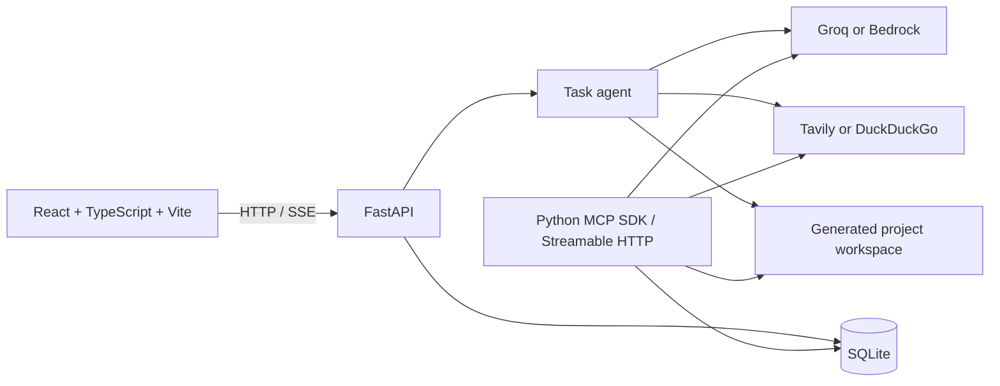

# NOVA AI

**Say it. NOVA builds it.**

NOVA is a local, voice-first AI assistant demo. It answers questions, researches the web with linked sources, and creates small React/Vite or FastAPI starter applications. The web UI is built with React, TypeScript, and Vite; a Python FastAPI service provides chat, task, project, and approval APIs; and an MCP server exposes NOVA tools over Streamable HTTP.

NOVA is an independent project. It is **not** an official Alexa+ integration, does not connect to Amazon's private Alexa+ preview, and has no wake-word detection. The microphone starts only when the user presses the button. Alexa+ track eligibility depends on successfully running and demonstrating the MCP server against the required protocol.

## Features

- **AI chat:** routes answers and code generation to the configured Groq or Amazon Bedrock provider. It does not switch providers automatically when the selected provider fails.
- **Web research:** retrieves results through Tavily when configured, otherwise attempts DuckDuckGo HTML search; the AI summarizes retrieved evidence and the UI displays source links.
- **Application generation:** creates a React/Vite or FastAPI starter inside `PROJECTS_ROOT`. When an AI provider is configured, it can generate code in a bounded set of files.
- **Human approval:** dependency installation is held for approval. Project commands are restricted to a short allowlist, run with timeouts, and do not launch long-running development servers. These controls are application safeguards, not an OS sandbox.
- **Voice:** browser speech recognition is manual, one-shot push-to-talk; browser speech synthesis can read responses aloud. Browser support and microphone permission are required.
- **Persistence:** messages, task states, project records, and approvals are stored in local SQLite.
- **MCP tools:** the local MCP service exposes question-answering, search, research, product comparison, project-file, task-status, and approval operations.

## Architecture



The browser sends chat messages to `POST /api/chat`. FastAPI records the message and task, then runs the task agent. Task updates are polled by the UI through an SSE endpoint. Research searches before summarization and supplies the retrieved URLs to the selected AI provider. Project creation uses built-in templates, optionally adds bounded AI-generated edits, and records an approval before installing dependencies.

## Alexa+ hackathon track notes

The published [Build, Ship, Shape rules](https://amazonappdev2026.devpost.com/rules) require the Alexa+ MCP-server path to use **MCP spec 2025-11-25 or later** and **Streamable HTTP**. The source invokes `mcp.run(transport="streamable-http")`; the installed Python MCP SDK is 1.30.0, whose source declares `LATEST_PROTOCOL_VERSION = "2025-11-25"`. This is source and installed-package evidence, not a live protocol-negotiation test. Before describing track compliance, run the server and verify the negotiated version with an MCP client; the service currently binds to loopback, so a judging client outside the machine would need an approved secure tunnel or reachable self-hosted endpoint.

The hackathon also asks for a repository URL, a project description, a public English demo video under three minutes (YouTube or Vimeo), and product feedback for each tool/API/SDK used. Public repositories need a visible open-source license; private repositories must be shared with `testing@devpost.com` and the Amazon reviewers listed in the rules. Check the current [official rules](https://amazonappdev2026.devpost.com/rules) and complete [docs/demo-checklist.md](docs/demo-checklist.md). If this project existed before the submission window, describe only the actual changes made during that window.

## Requirements

- Windows 10 or newer (the supplied launch scripts are PowerShell-specific)
- Python 3.11 or newer
- Node.js 20 or newer and npm
- A Groq API key and model, or AWS credentials plus Bedrock model access, for AI features
- Tavily API key recommended for reliable web research; without it, DuckDuckGo HTML search is attempted

## Configuration

Copy `.env.example` to `.env` if `.env` does not already exist, then edit the values locally. **Never commit `.env` or paste its contents into issues, logs, or demos.** Credentials remain in the backend environment and are not intentionally sent to the frontend.

```powershell
if (-not (Test-Path .env)) { Copy-Item .env.example .env }
```

Set `AI_PROVIDER=groq` and provide `GROQ_API_KEY` plus `GROQ_MODEL`, or set `AI_PROVIDER=bedrock` and provide `BEDROCK_MODEL_ID` and `AWS_REGION`. Bedrock credentials use the normal AWS credential chain (for example, an AWS profile); do not place AWS secret keys in frontend files. `TAVILY_API_KEY` is optional and independent of the AI provider.

| Variable | Purpose | Default / requirement |
|---|---|---|
| `AI_PROVIDER` | LLM route: `groq` or `bedrock` | `groq` |
| `GROQ_API_KEY` | Groq authentication | Required for Groq |
| `GROQ_MODEL` | Model available to the Groq account | Required for Groq |
| `AWS_REGION` | Bedrock region | `us-east-1` |
| `BEDROCK_MODEL_ID` | Bedrock model identifier | Required for Bedrock |
| `TAVILY_API_KEY` | Web search API key | Optional; DuckDuckGo fallback attempted |
| `DATABASE_PATH` | SQLite database path | `./data/nova.db` |
| `PROJECTS_ROOT` | Generated project directory | `./generated_projects` |
| `ALLOWED_ORIGINS` | Comma-separated FastAPI CORS origins | `http://localhost:5173` |
| `COMMAND_TIMEOUT_SECONDS` | Allowlisted command timeout | `45` |
| `DEPENDENCY_INSTALL_TIMEOUT_SECONDS` | Approved dependency setup timeout | `240` |

Relative database and workspace paths resolve from the repository root. Environment variables provided to the backend process override `.env` values.

## Install and run (Windows)

From the project root, configure `.env` and run the launcher once with dependency installation:

```powershell
.\scripts\Start-NOVA.ps1 -InstallDependencies
```

This creates `backend\.venv` if needed, installs Python requirements and npm dependencies, then opens separate windows for the backend, MCP service, and frontend. On later starts use:

```powershell
.\scripts\Start-NOVA.ps1
```

For manual setup:

```powershell
if (-not (Test-Path .env)) { Copy-Item .env.example .env }
python -m venv backend\.venv
backend\.venv\Scripts\python.exe -m pip install -r backend\requirements.txt
npm ci
```

Then, from separate PowerShell windows at the repository root, run:

```powershell
.\scripts\Run-Backend.ps1
.\scripts\Run-MCP.ps1
npm run dev
```

The local UI is `http://127.0.0.1:5173`, API health is `http://127.0.0.1:8000/api/health`, API docs are `http://127.0.0.1:8000/docs`, and MCP Streamable HTTP is `http://127.0.0.1:8001/mcp`. Services bind to loopback by default.

## Build and checks

Frontend production build (TypeScript check followed by Vite build):

```powershell
npm ci
npm run build
```

Backend syntax check:

```powershell
backend\.venv\Scripts\python.exe -m compileall backend\nova backend\run_backend.py backend\run_mcp.py
```

There is no committed automated test suite at this time. Use the [demo checklist](docs/demo-checklist.md) for manual API, MCP, provider, research, voice, project-generation, and approval verification. Do not report a check as passed until it has actually been run.

## Workflows

### Ask and research

Ask a question in the composer and submit with **Send**. For current topics, ask NOVA to research; it searches first and shows the retrieved source URLs alongside the answer. Tavily failures are surfaced; DuckDuckGo HTML parsing is best-effort and may be blocked or change.

### Generate an application

Describe the desired app. NOVA creates a supported starter under `generated_projects/`. When configured, the selected AI provider may generate request-specific code only in an explicit set of files. Review the project, then approve dependency installation in the UI. NOVA does not automatically start the generated app; start it manually from the project directory using its README instructions.

### Voice

Press the microphone button, speak, and review/edit the transcript before sending. Browser speech synthesis can speak responses. There is no always-listening mode or wake word. Browser speech recognition may transmit audio to the browser vendor's recognition service.

## MCP server

The MCP service uses the Python MCP SDK's FastMCP interface and Streamable HTTP transport at `http://127.0.0.1:8001/mcp`. It registers:

`answer_question`, `search_web`, `research_topic`, `compare_products`, `create_project`, `list_project_files`, `read_project_file`, `write_project_file`, `run_project_command`, `get_task_status`, and `request_human_approval`.

The server is local and has no authentication. Do not expose it publicly without appropriate authentication, authorization, TLS, and deployment controls. Dependency installation/build requests through supported interfaces require human approval. File tools are bounded to registered project roots and block common secret-file names; command execution is limited and is not a general shell.

## Troubleshooting

- **UI reports backend offline:** start `Run-Backend.ps1` and check `http://127.0.0.1:8000/api/health`; ensure port 8000 is free.
- **AI request fails:** check `AI_PROVIDER` and only that provider's settings, then restart the backend. NOVA does not silently switch providers.
- **Research fails:** if Tavily is configured, check key/account/usage; with no key, DuckDuckGo may block requests or change markup.
- **MCP client cannot connect:** start `Run-MCP.ps1`; verify loopback port 8001 and endpoint `/mcp`. The MCP server is independent of the API's port 8000.
- **Generated dependency setup fails:** inspect the approval/task output and generated app README. NOVA does not start the app server for you.

## Limitations

- This is a local demo, not a production service: it has no user authentication, multi-user authorization, or public deployment configuration.
- NOVA is not an official Alexa+ client, Agent Skill, or wake-word assistant. Alexa+ track use depends on independently verifying this MCP server against the hackathon's required protocol and showing it working in the demo.
- The MCP service binds to loopback and is not remotely reachable by judges without a separately configured secure tunnel or host.
- The app's command controls and project path checks are not an operating-system sandbox. Approved package installation can run package lifecycle scripts.
- DuckDuckGo HTML search is unstable; current result availability and AI output depend on external services and credentials.
- Built-in project templates are a React/Vite expense tracker and a standalone FastAPI starter; no paired frontend/backend template is included.
- Generated expenses use browser local storage. NOVA conversation/task/project metadata is stored locally in SQLite.
- No automated test suite is included. Build/runtime status must be established by running the documented checks.

## License

MIT. See [LICENSE](LICENSE).

